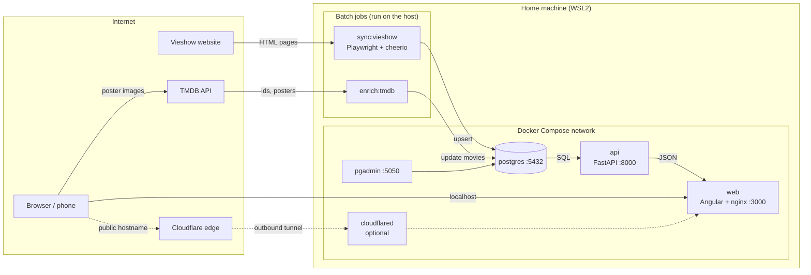
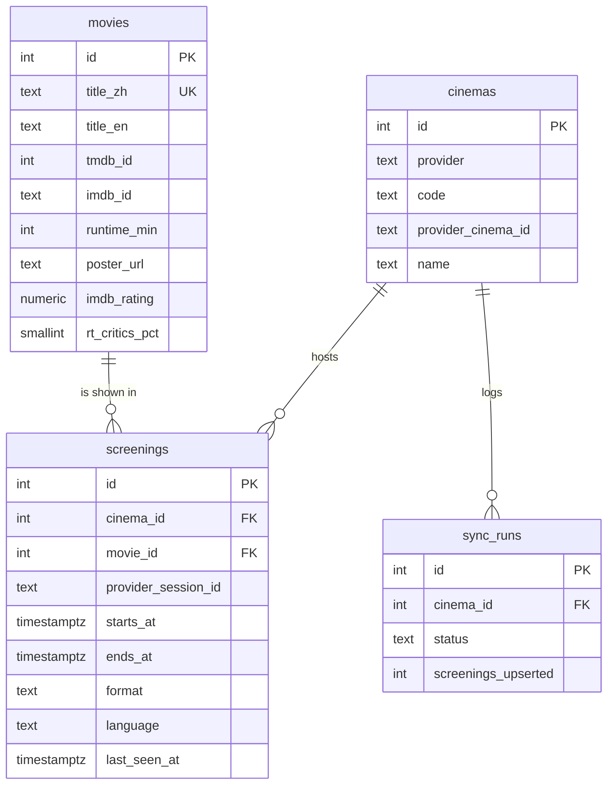

# System Architecture

TaipeiMovieCollector compares movie showtimes across Vieshow cinemas in Taipei and New Taipei on a shared timeline.
It is a personal, self-hosted project: a scheduled batch job collects data into PostgreSQL, and a read-only web app displays it.

## 1. Overview

The write path (batch jobs) and the read path (API and web page) only meet in the database.
The API and web page never call Vieshow or the TMDB API, so a failed or blocked sync leaves the site serving the previous data.

## 2. Technology stack

| Layer | Choice | Location |
|---|---|---|
| Web page | Angular 22, Tailwind CSS v4, TypeScript; served by nginx | `frontend/` |
| API | Python, FastAPI, psycopg | `backend/app/` |
| Database | PostgreSQL 17 | |
| Schema and migrations | Drizzle ORM and drizzle-kit | `backend/collector/src/db/` |
| Scraping | Playwright (headless Chromium, with the stealth plugin), cheerio | `backend/collector/` |
| Metadata | TMDB API | `backend/collector/` |
| Tests | pytest (API), Vitest with HTML fixtures (parsers) | |
| Deployment | Docker Compose; optional Cloudflare Tunnel | |

## 3. Components

Paths in 3.1 and 3.2 are relative to `backend/collector/`.

### 3.1 Showtime sync (`scripts/providers/vieshow/sync.mts`)

1. For each seeded cinema, open the booking page and parse the list of movie versions (`parse-movie-list.ts`).
2. Open each movie's session page and parse title, runtime, rating class, format, language and sessions (`parse-sessions.ts`, `parse-title.ts`).
3. Upsert `movies` and `screenings`. The end time is estimated as start + runtime + 15 minutes of trailers.
4. After a complete run only (no `--limit`), delete that cinema's future screenings that were not seen again.
5. Record the outcome in `sync_runs` (`ok`, `error` or `blocked`).

Request behaviour:

- One browser session, with a random 2–5 s pause between pages and 5–10 s between cinemas.
- A 403, 429, "Access Denied" or `/hold/` response stops the whole run. There is no retry, proxy or IP rotation.
- A parse or database error skips only the affected cinema.

It runs on the host rather than in Docker, because it needs a local Chromium and a residential connection.

### 3.2 Metadata enrichment (`scripts/enrich/tmdb.mts`, `src/lib/tmdb.ts`)

- Finds each film on TMDB and stores `tmdb_id`, `imdb_id` and a poster URL.
- A title match is mandatory: a missing poster is preferred over a wrong one.
- Manual corrections live in `scripts/seed/tmdb-overrides.json` and take precedence.
- Network errors, 429 and 5xx responses are retried with backoff. Unmatched films are checked again after 14 days.

### 3.3 API (`backend/app`)

One read-only endpoint, `GET /api/screenings`:

| Parameter | Meaning |
|---|---|
| `date` | Cinema day, `YYYY-MM-DD` |
| `c` | Comma-separated cinema codes (omitted = all) |
| `q` | Title search (Chinese or English) |

`main.py` validates the parameters, `db.py` queries the database, and `timeline.py` filters, groups and lays out the sessions.
The JSON shape is defined in `models.py` and mirrored in `frontend/src/app/core/models.ts`.

### 3.4 Web page (`frontend/src/app`)

A single page, `/`, using the same parameters as the API. The URL holds all filter state.

1. `pages/home` watches the URL and calls the API through `core/screenings.service.ts`.
2. It shows `FilterBar` and one `MovieCard` with a `TimelineMatrix` per film.
3. Changing a filter updates the URL, which triggers a new request. The cinema selection is also remembered in `localStorage`.

In development, `ng serve` forwards `/api` to port 8000 (`proxy.conf.json`). In production, nginx does the forwarding.
Session blocks link to Vieshow's official booking page for that movie.

### 3.5 Layout rules (`backend/app/timeline.py`, pure functions)

- A cinema day runs from 06:00 to 06:00 Asia/Taipei, so after-midnight shows stay with the previous evening.
- Entries that share a TMDB id are merged into one film card.
- Films are ordered by session count, then title.
- Within a card, cinemas are ordered by IMAX, then other premium halls, then special screenings, then standard; ties keep the configured order.
- Within a cinema row, overlapping sessions are packed into lanes, with premium formats on top.

## 4. Data model (`backend/collector/src/db/schema.ts`)

- `cinemas` is unique on `(provider, code)`, so another cinema chain can be added without a schema change.
- `screenings` is unique on `(cinema, provider session)` and on `(cinema, movie, start, format)`, which makes the sync safe to repeat.
- `tmdb_id` is not unique, because Vieshow may list one film under several titles.
- The rating columns exist but are not populated yet.
- Times are stored as `timestamptz` and displayed in Asia/Taipei.

## 5. Deployment

| Service | Exposure | Notes |
|---|---|---|
| `web` | `127.0.0.1:3000` | nginx serving the Angular build and forwarding `/api` |
| `api` | Compose network only | FastAPI, runs as a non-root user |
| `postgres` | `127.0.0.1:5432` | Data in the `pgdata` volume |
| `pgadmin` | `127.0.0.1:5050` | Database administration |
| `cloudflared` | outbound only | Compose profile `tunnel`; needs `CLOUDFLARE_TUNNEL_TOKEN` and a public hostname pointing to `http://web:3000` |

- Start the site: `docker compose up -d --build web`
- Weekly refresh: `backend/collector/scripts/ops/weekly-sync.sh` (sync, then enrich; logs in `backend/collector/.state/`), intended to be run by cron on Wednesday night. The cron entry has to be added by the operator.
- Configuration comes from `.env` (not committed); `.env.example` is the template.

See `README.md` for setup commands.

## 6. Security

- The web app has no authentication and no write endpoints.
- Service ports are bound to the loopback interface. Postgres and pgAdmin must not be exposed.
- A Cloudflare Tunnel makes the site public to anyone who knows the address; add a Cloudflare Access policy to restrict it.
- The TMDB key is used only by the batch job; the `api` container receives only the database connection settings.

## 7. Limitations and possible extensions

- Only Vieshow is supported. Miramar would need its own sync adapter.
- IMDb and Rotten Tomatoes scores (via OMDb) are planned but not implemented.
- Seat maps are out of scope: the seat pages are blocked by bot protection.
- Data is only as fresh as the last successful sync.
- The scheduled sync depends on the host machine and Docker being up.
- The data comes from third parties; check their terms before publishing the site. TMDB attribution is shown in the page footer.
